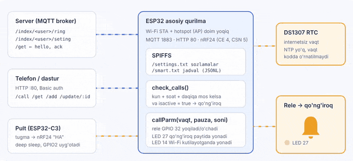
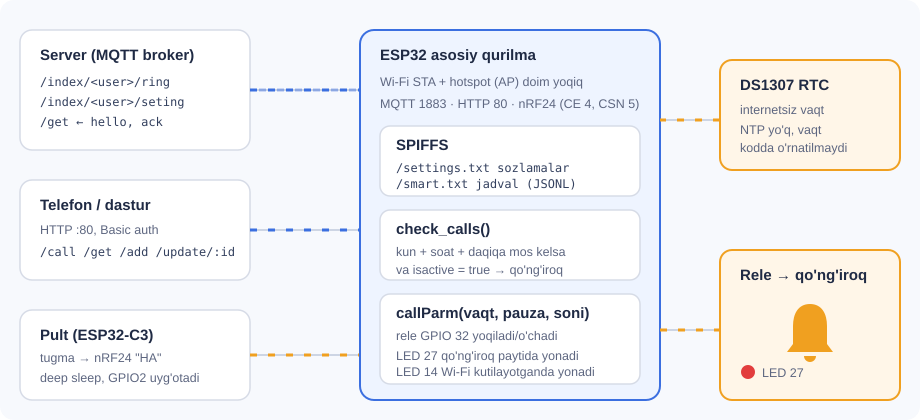

<div align="center">

# smart-call-esp

Aqlli qo'ng'iroq qurilmasi uchun ESP32 firmware. Qurilma jadval bo'yicha qo'ng'iroq chaladi, internet bo'lmasa ham ishlaydi, MQTT, HTTP va radio pult orqali boshqariladi.


[Qanday ishlaydi](#qanday-ishlaydi) ·
[HTTP](#http-api) ·
[MQTT](#mqtt-protokoli) ·
[Ulash](#ulanish-sxemasi) ·
[O'rnatish](#ornatish) ·
[Xavfsizlik](#xavfsizlik-va-cheklovlar)



</div>

> [!NOTE]
> Qurilmaning grafik interfeysi yo'q: u faqat JSON qaytaradi. Shuning uchun bu yerda screenshot o'rniga sxema berilgan. Hujjatdagi barcha nom va manzillar namuna sifatida keltirilgan (`mqtt.example.uz`, `YOUR_WIFI_SSID`).

## Qanday ishlaydi



**Ishga tushish** (`optimallshyotgan_call_online_va_offline_kodi.ino`):
1. SPIFFS ulanadi va `/settings.txt` dan sozlamalar o'qiladi.
2. DS1307 soati va nRF24 radio ishga tushadi.
3. Qurilma hotspot (AP) yoqadi va HTTP yo'nalishlarini ro'yxatdan o'tkazadi.
4. Wi-Fi'ga ulanishga harakat qiladi. Kutish paytida ham jadval, radio va HTTP ishlashda davom etadi.
5. Ulangandan keyin MQTT'ga ulanadi va `hello` xabarini yuboradi.

**Internetsiz rejim.** Jadval `/smart.txt` da saqlanadi, har bir qatorda bitta JSON. Vaqtni DS1307 soati beradi. `check_calls()` har daqiqada kun, soat va daqiqani solishtiradi. Mos kelsa va `isactive = true` bo'lsa, qo'ng'iroq chalinadi.

**Pult** (`smart_call_remote.ino`, ESP32-C3). Tugma bosilganda nRF24 orqali `"HA"` xabari yuboriladi. Asosiy qurilma uni qabul qilib `callParm(2000, 5000, 2)` ni chaqiradi: 2 s chaladi, 5 s pauza qiladi, 2 marta takrorlaydi. Pult taxminan 20 sikldan keyin deep sleep rejimiga o'tadi va GPIO2 orqali uyg'onadi.

### Sozlamalar (`/settings.txt`)

`update_id`, `mqtt_server`, `mqtt_user`, `mqtt_password`, `mqtt_client_id`, `subscribe_topic`, `seting_topic`, `publish_topic`, `hostpot_and_device_username`, `hostpot_password`, `device_login`, `device_pin`, `wifi_ssid`, `wifi_password`.

Sozlamalar saqlangandan keyin qurilma taxminan 30 s ichida qayta ishga tushadi.

### Jadval yozuvi (`/smart.txt`)

| Maydon | Turi | Ma'nosi |
|---|---|---|
| `id` | int | Yozuv raqami |
| `name` | string (3–50) | Nomi |
| `time` | `"HH:MM"` | Vaqt |
| `days` | array (1–7) | Hafta kunlari |
| `call_duration`, `call_delay`, `count` | int | Chalish davomiyligi, pauza, takrorlar soni |
| `isactive` | bool | Faolmi |
| `turn_off_after_work` | bool | Tekshiriladi, lekin kodda ishlatilmaydi |

## HTTP API

Port 80. Barcha so'rovlar HTTP Basic auth (`device_login` / `device_pin`) talab qiladi, aks holda 401 qaytadi.

| Usul | Yo'l | Vazifasi |
|---|---|---|
| GET | `/call` | Darhol chalish: 3 s × 2, oraliq 1 s |
| GET | `/pin` | Auth tekshiruvi, `iddevice` qaytaradi |
| GET | `/get` | Barcha jadval yozuvlari (JSON massiv) |
| POST | `/add` | Yozuv qo'shish, MQTT'ga `add_ring` yuboriladi |
| any | `/update/<id>` | Yozuvni yangilash, MQTT'ga `update_ring` yuboriladi |
| any | `/delete/<id>` | Yozuvni o'chirish |

## MQTT protokoli

Port 1883. `<user>` qiymati `SECRET_USER_MQTT` / `user_mqtt` dan olinadi.

| Topic | Yo'nalish | JSON maydonlari | Vazifasi |
|---|---|---|---|
| `/index/<user>/ring` | server → qurilma | `update_id`, `method`, `data` | `add`, `update`, `delete`, `check` (jadval) |
| `/index/<user>/seting` | server → qurilma | `type`, `data` | `user`: login va hotspot paroli; `device`: nom, PIN, Wi-Fi |
| `/get` | qurilma → server | `id`, `update_id`, `device_id` | Ulanganda `hello` xabari |
| `/get` | qurilma → server | `delete_id`, `device_id` | O'chirishni tasdiqlash |

MQTT'ga ulanganda `"type":"ofline"` belgili yozuvlar o'chiriladi.

## Ulanish sxemasi

| Qurilma | GPIO | Vazifasi |
|---|---|---|
| Asosiy (ESP32) | 4 / 5 | nRF24 CE / CSN |
| | 32 | Rele (qo'ng'iroq) |
| | 27 | LED: qo'ng'iroq chalinayotganda yonadi |
| | 14 | LED: Wi-Fi kutilayotganda yonadi |
| | I²C | DS1307 RTC |
| Pult (ESP32-C3) | 0 / 1 | nRF24 CE / CSN |
| | 2 | Tugma (deep sleep'dan uyg'otadi) |
| | 9, 10 | LEDlar |

## O'rnatish

1. Arduino IDE'da ESP32 platasini o'rnating. Pult uchun ESP32-C3 kerak (core 3.x).
2. Kutubxonalar: ArduinoJson **6.x**, PubSubClient 2.8, Adafruit RTClib, RF24 (TMRh20), ESP32WebServer.
3. Har bir sketch papkasida `secrets.example.h` ni `secrets.h` ga nusxalang va qiymatlarni to'ldiring:

```bash
cp source/optimallshyotgan_call_online_va_offline_kodi/secrets.example.h source/optimallshyotgan_call_online_va_offline_kodi/secrets.h
```

```bash
cp source/smart_call_remote/secrets.example.h source/smart_call_remote/secrets.h
```

| Makros | Vazifasi |
|---|---|
| `SECRET_MQTT_SERVER`, `SECRET_MQTT_USER`, `SECRET_MQTT_PASSWORD`, `SECRET_MQTT_CLIENT_ID` | MQTT broker |
| `SECRET_USER_MQTT`, `SECRET_USER_MQTT_DEVICE_ID` | Topic'dagi foydalanuvchi va qurilma raqami (raqam bo'lishi kerak) |
| `SECRET_WIFI_SSID`, `SECRET_WIFI_PASSWORD` | Wi-Fi tarmog'i |
| `SECRET_HOTSPOT_SSID`, `SECRET_HOTSPOT_PASSWORD` | Qurilma hotspoti (parol kamida 8 belgi) |
| `SECRET_DEVICE_LOGIN`, `SECRET_DEVICE_PIN` | HTTP Basic auth |
| `SECRET_RADIO_ADDRESS` | nRF24 manzili, ikkala sketch'da **bir xil** bo'lishi shart |

`secrets.h` `.gitignore` da turadi va GitHub'ga yuklanmaydi. Fayl bo'lmasa, kompilyatsiya `#error` bilan to'xtaydi.

## Xavfsizlik va cheklovlar

> [!WARNING]
> Repo tarixida avval kodga yozilgan MQTT tokeni (JWT), Wi-Fi paroli va qurilma PIN kodi qolgan. **Ularni almashtiring.** Tarixni `git filter-repo` bilan tozalash mumkin.

- **Shifrlash yo'q.** MQTT (1883) va HTTP (80) ochiq matnda ishlaydi. Sozlamalar ham `/settings.txt` da ochiq saqlanadi.
- **Parol ochiq taqqoslanadi.** HTTP auth `device_login` va `device_pin` ni to'g'ridan-to'g'ri solishtiradi. `hash.cpp` (SHA-256 + salt) bor, lekin hech qayerda chaqirilmaydi.
- **Vaqtni qo'lda o'rnatish kerak.** RTC kodda o'rnatilmaydi va NTP yo'q. DS1307 vaqtini oldindan o'rnating.
- **`/update` va `/delete`** istalgan HTTP usulini qabul qiladi.
- **`hello` xabari.** `user_mqtt_device_id` JSON'ga qo'shtirnoqsiz yoziladi, shuning uchun u raqam bo'lishi kerak.
- **Kompilyatsiya qilinmagan.** Bu o'zgarishlar bu sessiyada kompilyatsiya qilinmagan: ESP32 toolchain'ini yuklab bo'lmadi. Qurilmaga yozishdan oldin Arduino IDE'da tekshiring.

### Shu versiyadagi tuzatishlar

| Muammo | Oldin | Keyin |
|---|---|---|
| Kodga yozilgan sirlar | 13 ta (`variables.cpp`) | **0**, `secrets.h` ga ko'chirildi |
| Serial portga parol, PIN va token chiqishi | 6 joyda | **yashirilgan** (`*** (len=N)`) |
| MQTT orqali jadval qabul qilish | `!validateFields`: faqat **noto'g'ri** yozuvlar saqlanardi | to'g'ri yozuvlar saqlanadi |
| Sozlama qayta yuklanganda `strdup` | har safar xotira oqib ketardi | `setConfigStr()` eskisini bo'shatadi |
| `isactive = false` yozuvlar | baribir chalinardi | **chalinmaydi** |
| Manfiy `count` | cheksiz chalardi | `count > 0` tekshiriladi |
| Chalish paytida `delay()` | MQTT ulanishi uzilardi | `keepAliveDelay()` `client.loop()` ni chaqiradi |
| `/smart.txt` o'qilishi | har `loop()` da | daqiqada bir marta |
| nRF24 buferi | 32 bayt, `strcmp` chegaradan chiqardi | 33 bayt |
| `millis()` taymerlari | `int`, ~24.8 kundan keyin buzilardi | `unsigned long` |
| `compare_passwords` | oddiy taqqoslash | doimiy vaqtli taqqoslash |

> [!IMPORTANT]
> MQTT tuzatishidan keyin server yuborgan to'g'ri jadvallar endi haqiqatan saqlanadi. Backend xabarlarida barcha maydonlar (yuqoridagi jadvalga qarang) bo'lishini tekshiring.

## Loyiha tuzilishi

```
source/optimallshyotgan_call_online_va_offline_kodi/
  *.ino                 setup/loop: SPIFFS, RTC, nRF24, AP+STA, HTTP, MQTT
  variables.cpp/.h      pinlar, sozlamalar, /settings.txt
  pubsub_client.cpp/.h  MQTT callback (ring, seting)
  server_functions.*    HTTP handlerlar, Basic auth
  utils.cpp/.h          jadval (/smart.txt), callParm, check_calls, nRF24
  hash.cpp/.h           SHA-256 + salt (hozircha ishlatilmaydi)
  secrets.example.h     sozlama namunasi
source/smart_call_remote/
  smart_call_remote.ino pult: tugma → nRF24 "HA", deep sleep
  secrets.example.h
docs/media/             README sxemalari
```

## Litsenziya

[MIT](LICENSE) © 2024 AbduazizBobomalikovNode

## Muallif

**Bobomalikov Abduaziz** · GitHub [@AbduazizBobomalikovNode](https://github.com/AbduazizBobomalikovNode) · tashkilot [abdusoft-uz](https://github.com/abdusoft-uz)
